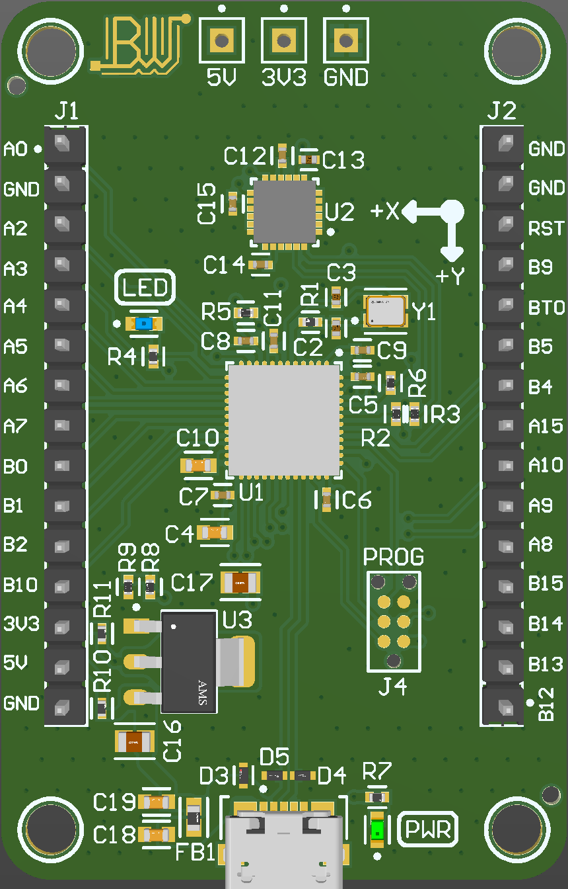
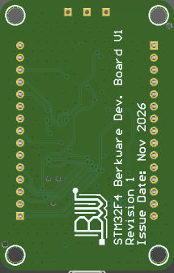

# STM32F4 Berkware Development Board

A custom development board built around the **STM32F411CEU6** ARM Cortex-M4 microcontroller, designed for embedded systems development, sensor interfacing, and hardware prototyping.

The board integrates an **MPU-6050 6-axis IMU**, native USB 2.0 connectivity, onboard power regulation, and breakout headers providing access to the MCU's available GPIO pins and peripheral interfaces.

## Hardware Features

- **Microcontroller:** STM32F411CEU6 (ARM Cortex-M4)
- **Motion Sensing:** MPU-6050 3-axis accelerometer and 3-axis gyroscope, connected via I²C with interrupt support
- **USB Interface:** Micro-USB connector with USB 2.0 data lines, ESD protection, and input power filtering
- **Power Supply:** USB 5V input with AMS1117-3.3 LDO regulation
- **Clock:** External 24 MHz crystal oscillator
- **Programming & Debugging:** Dedicated SWD interface with reset and SWO connections
- **GPIO Expansion:** Dual pin headers exposing MCU I/O, power, reset, and BOOT0 signals
- **Power Monitoring:** Resistor-divider circuit for measuring input voltage through the MCU ADC
- **Status Indicators:** Onboard power LED and MCU-controlled user LED
- **Power Access:** External 5V, 3.3V, and GND connections

## PCB 3D View

### Top View

### Bottom View

## Schematic

The schematic is organized into hierarchical sheets covering the MCU, IMU, power supply, and USB interface.

[View / Download Complete Schematic (PDF)](Media/STM32F4_BerkwareDevBoard.pdf)

## Project Scope

This project covers component selection, schematic design, peripheral integration, PCB layout and routing, and 3D board visualization using **Altium Designer**.

## Tools

**EDA Software:** Altium Designer
